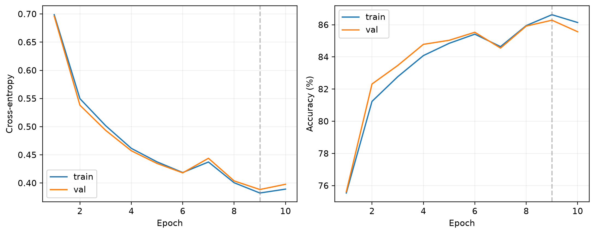
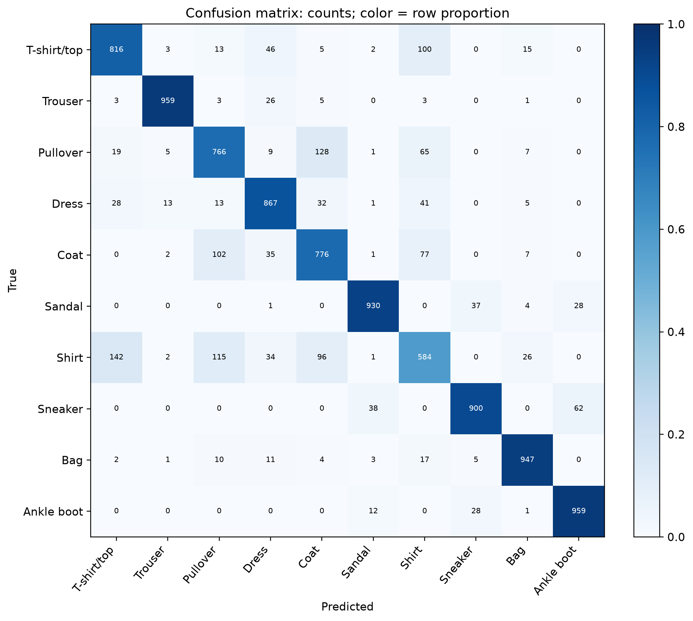
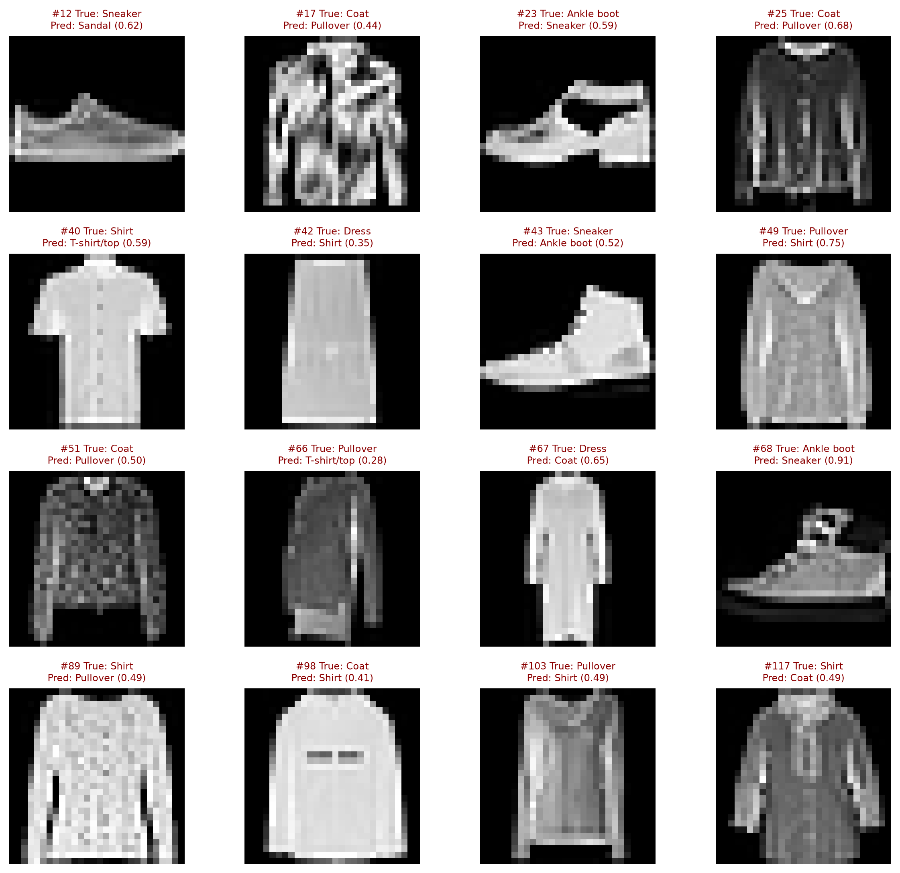

# Fashion MNIST 多层感知机基线实验结果

本次在正式 Fashion-MNIST 数据集上完成了784→256→10多层感知机的10轮训练。按验证集交叉熵最小选择第9轮检查点，独立测试集准确率为85.04%，Macro-F1为0.8494。本结果对应报告题目3的单种子基线，尚未完成三种子容量对照和题目4的 MNIST 实验。

## 实验设置

官方训练集60000张图像按固定随机种子2026划分为54000张训练样本和6000张验证样本，独立测试集包含10000张图像。灰度像素缩放至0—1，28×28图像展平为784维输入。隐藏层使用256个单元及ReLU，输出10个类别的logits，交叉熵前不重复使用Softmax。

网络共203530个参数，采用小批量SGD，学习率0.1、批量大小256，权重初始化为标准差0.01的正态分布，偏置初始化为0。训练随机种子为42，计算设备为CPU。

## 实测指标

|指标|结果|
|---|---:|
|训练轮数|10|
|按验证损失选择的轮次|9|
|选定检查点训练准确率|86.6241%|
|选定检查点验证准确率|86.2833%|
|选定检查点测试准确率|85.0400%|
|测试 Macro-F1|0.8494|
|测试交叉熵|0.421744|
|测试正确样本数|8504 / 10000|
|训练与测试准确率差距|1.5841个百分点|
|训练及逐轮训练集和验证集评估耗时|23.20秒|

耗时不包括数据下载与最终绘图。以上为单种子结果，不能填写为三种子均值和标准差。

## 可用于报告的结果分析

训练过程中，验证集交叉熵从第1轮的0.6961降至第9轮的0.3885，验证准确率从75.6167%提高至86.2833%，说明网络在当前设置下有效学习了服装图像的分类特征。第7轮和第10轮出现短期波动；第10轮训练损失和验证损失均上升，因此不能仅据该轮验证损失回升就判断存在过拟合。模型按预先设定的验证损失最小规则选择第9轮检查点，最终在独立测试集上取得85.04%的准确率。

混淆矩阵显示，错误主要集中在外观相近的上装类别。Shirt被误判为T-shirt/top共142张，Pullover被误判为Coat共128张，Shirt被误判为Pullover共115张。Shirt类别召回率仅58.4%，是本次模型识别的主要薄弱环节。错分样本中可观察到相近的上身轮廓和袖形，低分辨率灰度图像中的细节差异较弱。这些观察与上装类别间的混淆相符，但尚不能据此确定全部错误的成因。

后续可通过相同数据划分和训练预算下的Softmax回归、10单元MLP及双隐藏层MLP对照，检验非线性表示和容量变化的影响，并通过三个训练种子报告结果波动。本次基线本身不能证明增加隐藏层必然改善结果。

## 报告用图

图1 训练与验证曲线，虚线表示选中的第9轮检查点。

图2 测试集混淆矩阵，行表示真实类别，列表示预测类别；数字为样本数，颜色表示行内比例。

图3 按固定测试顺序选取的前16个错分样本。

## 运行故障及处理

首次运行在下载训练图像时中断，残留文件为20908536字节，未通过完整性检查，训练尚未开始。修复后从[数据集官方仓库](https://github.com/zalandoresearch/fashion-mnist)对应的HTTPS源下载，保留超时重试与备用源，并对四个压缩包逐一核对发布方MD5，确认完整后再解压加载。校验结果如下。

|文件|压缩包字节数|MD5|
|---|---:|---|
|train-images-idx3-ubyte.gz|26421880|8d4fb7e6c68d591d4c3dfef9ec88bf0d|
|train-labels-idx1-ubyte.gz|29515|25c81989df183df01b3e8a0aad5dffbe|
|t10k-images-idx3-ubyte.gz|4422102|bef4ecab320f06d8554ea6380940ec79|
|t10k-labels-idx1-ubyte.gz|5148|bb300cfdad3c16e7a12a480ee83cd310|

正式结果目录为 `D:\Pycharm\Poj2\mlp_results\20261109_065420_483149`。目录内保存环境记录、数据划分索引、训练历史、逐类指标、完整预测和模型权重，可用于核验报告中的数据。

